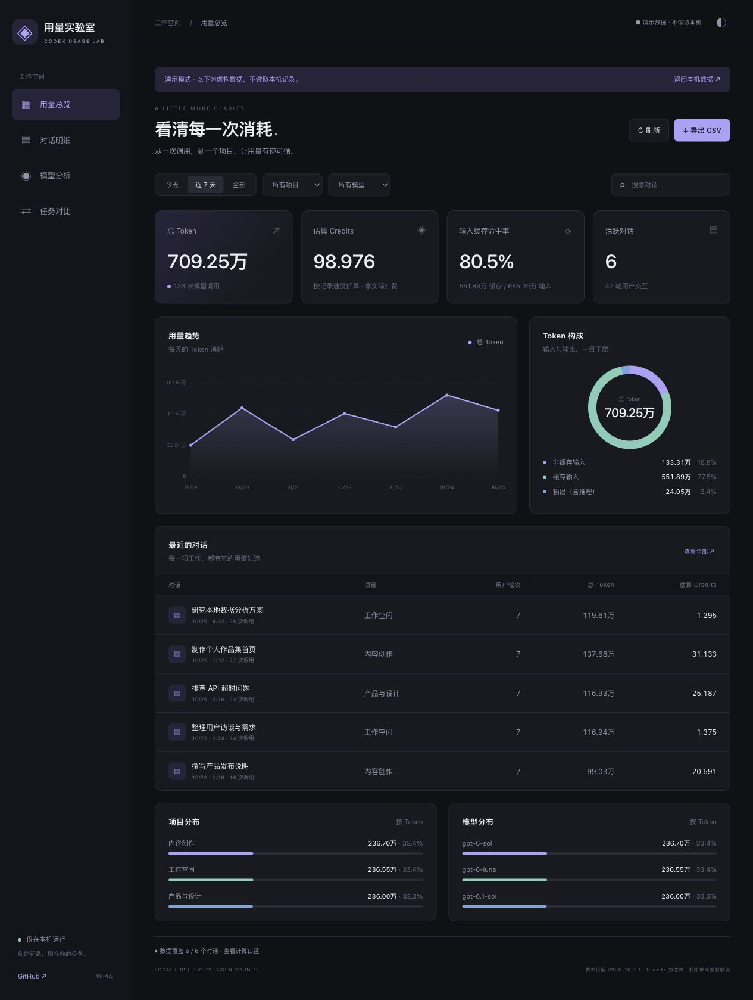

# ◈ Codex Usage Lab · 用量实验室

**看清每一次消耗。** 本机运行的 Codex 用量看板：从 Token 构成和每日趋势，下钻到对话、用户轮次与每次模型调用。



## 能做什么

- **清晰总览**：总 Token、估算 Credits、输入缓存命中率、活跃对话，每 10 秒自动刷新。
- **趋势与构成**：每日趋势、非缓存输入 / 缓存输入 / 输出、项目和模型分布。
- **逐层追踪**：对话 → 用户轮次 → 模型调用，查看模型、速度、推理强度和用量。
- **同类任务对比**：手动标注任务和结果，比较平均 / 中位 Credits、计价覆盖和样本数。
- **轻巧界面**：深色 / 浅色、手机布局、时间 / 项目 / 模型筛选、CSV 导出。
- **Codex 工具**：MCP 查询和可选界面资源。宿主是否显示原生面板取决于客户端支持，不能保证在每个版本中出现。
- **可选小字条**：`inline/` 中的实验功能，把本轮用量放在「用时」旁边，不占侧栏。

## 快速体验

需要 Python **3.10+**。网页运行无需 Node 或第三方 Python 包。

```sh
git clone https://github.com/yangs-saber/codex-usage-lab.git
cd codex-usage-lab
python3 run.py --demo
```

打开 [演示页面](http://127.0.0.1:8770/?demo=1)。演示服务只加载仓库内的虚构数据，**不扫描本机日志**。

读取真实本机用量：

```sh
python3 run.py
# 端口被占用时：python3 run.py --port 8771
```

打开 [本机看板](http://127.0.0.1:8770/)。首次索引可能需要数十秒。数据库来自 `$CODEX_HOME`（默认 `~/.codex`）；需要本机保存有逐次用量记录。压缩 `.jsonl.zst` 日志另需系统安装 `zstd`。SQLite 字段和事件格式随 Codex 版本变化，未知格式可能不被识别；本项目不是 OpenAI 官方产品。

## Codex 插件 / MCP

仓库含本地插件市场清单，可在支持本地插件的 Codex CLI 中安装：

```sh
codex plugin marketplace add .
codex plugin add codex-usage-lab@ekko-local-tools
```

清单使用 `python3` 和 `${PLUGIN_ROOT}`，没有机器专属路径。若当前宿主没有加载插件 MCP 工具，可单独添加：

```sh
codex mcp add usage_lab_local -- python3 /absolute/path/to/codex-usage-lab/plugins/codex-usage-lab/mcp_server.py
```

在新聊天中使用用量实验室技能，或调用 `query_usage`（支持 thread / turn / call / model / project / comparison）。`open_usage_dashboard` 声明 MCP App 资源；目前只验证本地 HTTP 看板，客户端内原生资源展示因版本而异。

通过 `/?thread_id=<明确的对话ID>` 可只看一个对话。不会把最近活跃对话冒充当前对话。

## 可选：回复旁的小字条

参见 [inline/说明.md](inline/说明.md)。macOS 启动文件会请你正常退出 Codex，然后在你确认后用仅绑定 `127.0.0.1` 的临时调试端口启动。它不修改应用包、签名或 CSP，也不安装开机任务。

**实验功能**：依赖 Codex 的内部页面结构，版本更新可能使匹配失效。调试端口可控制应用页面，本机其他进程也可能连接；普通重启应用会关闭端口。自动化控制工具可能禁止操作 Codex 自身；不要绕过宿主限制。

## 数据口径

- 输入包含缓存输入，输出包含推理 Token，**均不重复相加**。
- 一轮用户交互可能包含多次调用和多个模型。
- Credits 按 **2026-10-23 费率快照**重算，用于比较；不是实际扣费、历史账单或套餐额度百分比。费率来源：[OpenAI Credits pricing](https://learn.chatgpt.com/docs/pricing)。快照定义在 `collector.py`。
- 缺少速度时明确按 Standard 估算；未知模型或速度显示「未计价」，不当作免费。单独收费的工具不包含在内。
- 只统计本机保留的逐次记录，按 response ID 去重。旧版累计数据和分叉继承历史不混入；覆盖与差额单独报告。
- 平均 / 中位 Credits 只纳入完整计价的轮次，并展示覆盖数。跨模型轮次进入多个比较组；整轮结果不等于某个模型的独立贡献。
- 图表按上海时区显示日期；长时间范围最多分成 60 个时间桶，悬停可看每桶起始日期与 Token。

## 隐私

服务仅监听 `127.0.0.1`，没有上传日志、分析遥测或外部字体。只读 Codex 元数据和用量日志；持久化的唯一业务写入是你主动保存的任务 / 结果标注，默认放在 `~/.local/share/codex-usage-lab`，可用 `USAGE_LAB_DATA` 指定。不会修改原始会话。

聊天标题、项目名、标注、导出的 CSV 都可能包含私人信息，请勿提交到公开仓库。仓库预览和 `demo.json` 均为虚构数据。不应将本地服务通过隧道暴露到公网。

## 开发与测试

```sh
python3 -m unittest discover -s tests -v
node --check plugins/codex-usage-lab/dashboard.js
```

看板源码为 `index.html`、`dashboard.css`、`dashboard.js`。本地 HTTP 服务白名单提供静态资源。MCP 面板源码位于 `ui-src/`，修改后构建：

```sh
cd plugins/codex-usage-lab/ui-src
npm ci
npm run build
```

Node 仅用于构建 MCP 资源与实验小字条。`meter.html` 是已生成的单文件资源，运行时无需 npm 安装。

## 致谢与许可证

MIT。[Codex Usage Tracker](https://github.com/douglasmonsky/codex-usage-tracker) 的 MIT stdio MCP 通信层被适配于 `mcp_server.py`，原始版权和许可证保留在 [THIRD_PARTY_LICENSE.txt](plugins/codex-usage-lab/THIRD_PARTY_LICENSE.txt)。统计逻辑与中文看板为本项目实现。

小字条实现方式参考 [Codex AutoSkin](https://github.com/Finderchangchang/codex-autoskin) 的本机运行时定制思路，未复制或执行其安装脚本。第三方包由锁文件记录，许可证见 [THIRD_PARTY_NOTICES.md](THIRD_PARTY_NOTICES.md)。欢迎通过 Issue 提供脱敏格式样例，请不要上传原始会话或登录信息。
